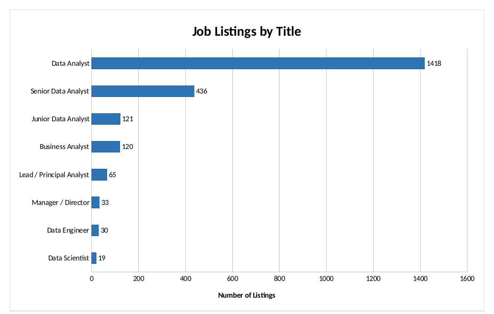
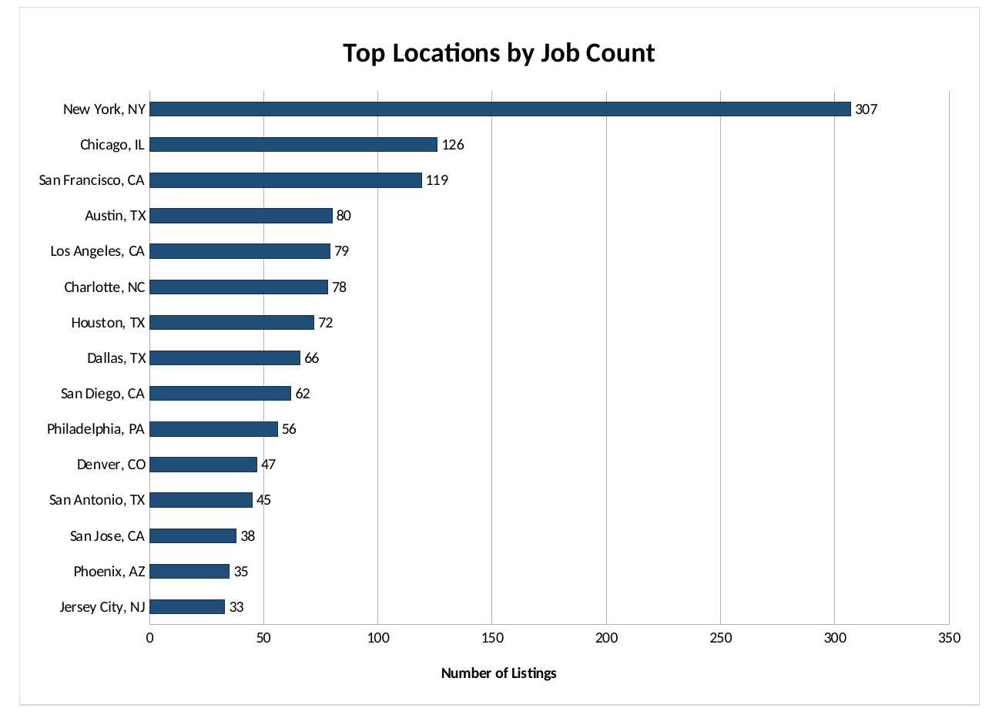
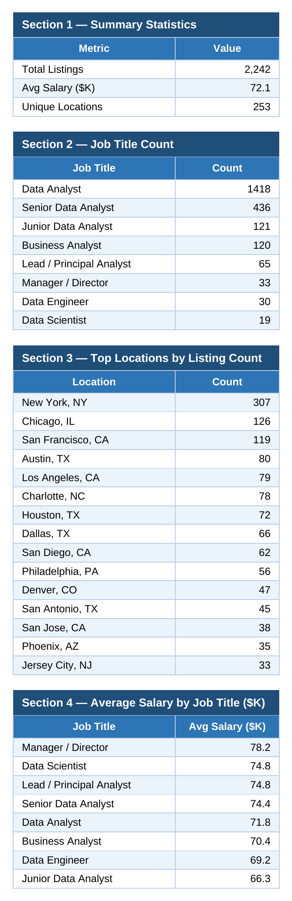

# Data Analyst Job Market Analysis (Excel)

An Excel analysis of 2,242 US Data Analyst job listings from Glassdoor. The goal was to clean messy job-board data and find out which roles, cities and salary levels show up most.

## Key Findings

- **Most listings are general analyst roles.** 63% are plain "Data Analyst" jobs and 19% are Senior roles. Junior roles are only about 5%, so entry-level postings are relatively scarce.
- **New York leads by a wide margin.** With 307 listings (14% of the total), New York has more than twice as many as the next city, Chicago (126).
- **By state, California and Texas lead.** California (623) and Texas (393) beat New York state (342), because their jobs are spread across many cities: Texas has four cities in the top 15 (Austin, Houston, Dallas, San Antonio).
- **The average salary midpoint is about $72K** (median $69K).
- **Salary barely changes with seniority in this data.** Junior roles average $66K and Manager/Director roles $78K, a gap of only $12K. See the limitation below for why this probably understates the real gap.

## Visualizations

### Job Listings by Title

### Top Locations by Job Count

### Analysis Sheet
All counts and averages below are live `COUNTIF` / `AVERAGEIF` formulas on the cleaned data.

## Data

- **Source:** Kaggle "Data Analyst Jobs" dataset, scraped from Glassdoor in 2020 (US listings only)
- **Raw size:** 2,253 listings with title, salary estimate, company, location, rating, industry and company details

## Cleaning Steps

- Removed 11 duplicate listings (same job title, company and location)
- Removed the Glassdoor rating stuck onto the end of company names (e.g. "Squarespace 3.4" → "Squarespace")
- Turned Glassdoor's `-1` placeholder into blank cells instead of deleting those rows, so the 268 listings from companies with no rating (often smaller or newer firms) stay in the analysis
- Standardised locations to "City, ST" and added a State column
- Converted salary ranges into numeric midpoints (e.g. "$37K–$66K" → 51.5)
- Grouped 1,000+ different job titles into 8 categories using written keyword rules, checked in a fixed order (full rules in the **Notes** sheet)

## Limitation: Salary Estimates

The salary ranges come in blocks of about 28 listings in a row with the exact same range, covering junior and senior jobs alike. That means Glassdoor attached the estimate to the search, not to each individual job. So the overall average is a reasonable rough guide, but the salary-by-title comparison is weak evidence. The data is also from 2020 and US-only, so pay levels are out of date and may not reflect Canada.

## Workbook Structure

| Sheet | What it does |
|---|---|
| **1. Raw Data** | Original listings, unchanged |
| **2. Clean Data** | Cleaned listings with title category, location, state and salary midpoint |
| **3. Analysis** | Summary stats, counts by title and city, average salary by title (all `COUNTIF` / `AVERAGEIF` formulas) |
| **4. Charts** | Bar charts built from the Analysis sheet |
| **5. Notes** | Cleaning rules, title grouping rules and limitations |

## Tools Used

Microsoft Excel · COUNTIF / AVERAGEIF / SUMPRODUCT · Excel charts

## Files

- `DataAnalyst_Jobs_Analysis.xlsx`: raw data, cleaned data, analysis, charts and notes
- `job_titles.png`, `locations.png`, `workbook-analysis.png`: chart and workbook images
